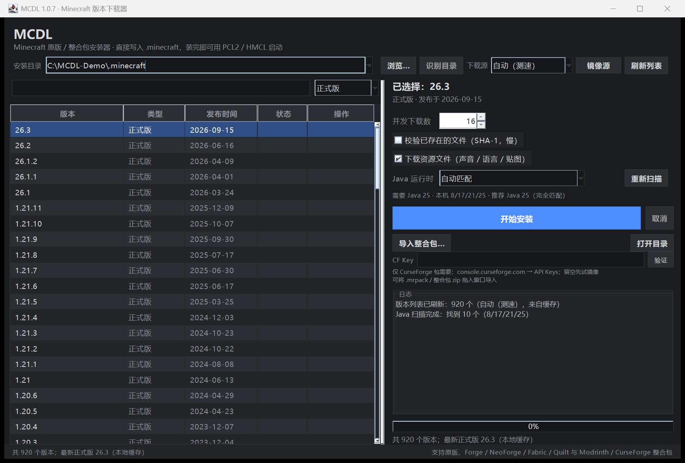

# MCDL 1.0.7 — Minecraft 原版下载器



> **起因**：PCL 2.99.0.0（2026-10-20）的更新说明写着「为遵守相关法律法规，PCL 不再提供 MC 下载功能」。
> 启动器不再帮你下本体了，但「下载游戏文件」本身只是一串公开的 HTTP 请求——
> 于是照着 PCL2 与 HMCL 的下载逻辑，自己写了一个替代品。

> 变更记录见 [CHANGELOG.md](CHANGELOG.md)。

MCDL 是一个**零第三方依赖**的 Java 小工具：把任意原版 Minecraft（正式版 / 快照 / 远古版本）
需要的全部文件，按标准 `.minecraft` 目录结构落盘。装完之后，PCL2 / HMCL 的版本列表里直接就能看到并启动。

---

## 1. 它能做什么

| 能力 | 说明 |
|---|---|
| 版本列表 | 从官方 / BMCLAPI 拉 `version_manifest_v2.json`，正式版、快照、远古版本全都有（当前 920 个） |
| 目录识别 | 自动找 PCL2 / HMCL 的游戏目录，下载完直接出现在启动器版本列表 |
| 整合包 | 导入 Modrinth `.mrpack`（免 key）与 CurseForge zip（需 API key）；支持按钮选择与窗口拖拽 |
| 下载本体 | 版本 JSON、客户端 jar、全部依赖库、旧版 natives（自动解压到 `versions/<id>/natives`） |
| 下载资源 | 资源索引 + 全部 assets 对象（声音、语言、贴图…）+ log4j 配置 |
| 旧版兼容 | `virtual` / `map_to_resources` 资源索引会额外复制到 `assets/virtual/…` 或 `resources/…` |
| 镜像 | 官方 / BMCLAPI / **自动测速**三种模式；每个文件都有候选 URL，失败自动换下一个 |
| 可靠性 | `.part` 断点续传、SHA-1 校验、原子改名、并发下载、已存在文件跳过 |
| 修复 | `--verify` 对已存在文件做哈希校验，坏文件自动重下 |
| Java | 自动扫描本机 Java（注册表 / PATH / 目录 / 启动器运行时），按版本要求匹配并核实 |
| 两种入口 | Swing 图形界面 + 命令行（可脚本化） |

## 2. 它不做什么（v1 的边界）

- **不单独「装加载器」**——只有导入整合包时会自动装 Fabric / Quilt / Forge / NeoForge；没有「给已有版本单独加 Forge」的入口（那部分可以交给 PCL 的「修改版本」）。
- **不启动游戏、不登录**——本工具只负责「把文件准备齐」，启动仍然交给 PCL2 / HMCL。
- **不下载 Java 运行时**——但会**自动发现本机已有的 Java**，并告诉你「这个版本要 Java 几、该用哪一个」（Mojang JRE 的分发是 lzma 压缩 + 按文件清单，留作后续）。

## 3. 快速开始

要求：**JDK 17 或更高**（编译用 `--release 17`，运行 17/21/25 都行）。

发布包有两种（见第 16 节）：

| 包 | 内容 | 适合 |
|---|---|---|
| `MCDL-1.0.7.zip` | jar + 原生选择器 + 启动脚本 + 源码（约 400 KB） | 本机已有 Java 17+ |
| `MCDL-1.0.7-portable.zip` | 自带 Java 17 运行时 + `MCDL.exe`（23.7 MB） | 不想装 Java，双击即用 |

> 如果系统的默认 `java` 太旧（比如 PATH 里第一个是 Java 8），可以：
> `set MCDL_JAVA=C:\Program Files\Eclipse Adoptium\jdk-25.0.4.101-hotspot\bin\javaw.exe` 后再双击 `启动.bat`，
> 或用 `mcdl.bat --java <路径>`。MCDL 自己会扫描并列出机器上所有 Java（见第 13 节）。
>
> 便携版如果「打开文件夹」被安全软件（如火绒 HIPS）拦截，可以改用便携版目录里的 `启动.bat`
> 启动（进程是 `javaw.exe` 而不是 `MCDL.exe`），或把 `MCDL.exe`、`java.exe`
> 加入信任区；系统 shell 被拦截时，MCDL 会打开应用内文件夹窗口兜底。

```bat
build.bat                 :: 编译，产物 mcdl.jar
启动.bat                  :: 打开图形界面
mcdl.bat --list           :: 命令行：列出正式版
mcdl.bat --install 1.20.1 :: 命令行：装到 %APPDATA%\.minecraft
```

> `build.ps1` 与 `build.bat` 等价。若 PowerShell 提示「脚本未签名」，用 `build.bat`，
> 或 `powershell -ExecutionPolicy Bypass -File build.ps1`。

## 4. 图形界面

- 顶部：**安装目录**（自动识别 PCL / HMCL 用的目录，也可浏览或手动输入）+ **下载源** + 刷新。
- 剪贴板里出现 Modrinth / CurseForge 项目页、版本页或整合包直链时，顶部会显示「检测到链接，导入？」提示条。
- CF Key 输入框旁有「验证」按钮，可立即确认 key 有效 / 无效 / 被限流。
- 下载源旁有「镜像源」按钮：可添加自定义镜像、删除、置顶，并测速查看延迟与成功率。
- 导入整合包前会先弹预检卡片：MC 版本、加载器、文件数、预计下载体积、overrides 体积、磁盘空间与路径警告，确认后才开始。
- 左侧：版本列表，支持搜索版本号、按「全部 / 正式版 / 快照 / 远古」过滤；最后一列显示「已安装」。
- 右侧：并发数、是否校验、是否下载资源、**Java 运行时**（自动匹配 / 手动指定）；开始安装 / 取消；进度条 + 速度 + 剩余时间 + 实时日志。
- 双击某个版本 = 直接开始安装。

版本清单会缓存到 `%USERPROFILE%\.mcdl\cache\`（10 分钟），第二次打开界面基本瞬间出列表。

### 自动识别 PCL / HMCL 的游戏目录

MCDL 启动时会自动识别本机启动器在用的 `.minecraft`，直接装进去，不用手动搬目录：

- **PCL2**：注册表 `HKCU\Software\PCL\LaunchFolders`；以及找到 `Plain Craft Launcher 2.exe` 后读
  `<exeDir>\PCL\Setup.ini` 里的 `LaunchFolderSelect`（PCL 的「当前游戏目录」就存这里）；
  同时把 exe 旁边的 `.minecraft` 也算候选（便携版布局）。
- **HMCL**：`%APPDATA%\.hmcl\config\user-game-directories.json` 里的 `directories[].path`；
  兼容老版 `hmcl.json` 的 `gameDir`。
- **兜底**：扫 `%APPDATA%`、各盘符浅层，以及带 `PCL.ini` / 版本内 `.hmcl` 标记的目录。

下拉框里会标明来源，例如
`C:\Users\xxx\AppData\Roaming\.minecraft · HMCL + PCL 当前 + 默认，10 个版本`，
优先级：启动器当前目录 > 启动器已知目录 > 版本数多的目录 > 默认目录。
命令行对应 `--list-dirs`；`--install` 不写 `--dir` 时会自动用识别结果。

## 5. 命令行

```
java -jar mcdl.jar                         打开图形界面
java -jar mcdl.jar --list [--type all]     列出可用版本
java -jar mcdl.jar --list-java             扫描并核实本机所有 Java
java -jar mcdl.jar --install <版本id>       安装
java -jar mcdl.jar --dry-run <版本id>       只分析、打印计划，不下载
```

| 选项 | 说明 |
|---|---|
| `--dir <路径>` | 安装目录；不填则自动识别 PCL / HMCL 的目录 |
| `--list-dirs` | 列出识别到的 PCL / HMCL 游戏目录 |
| `--install-pack <文件>` | 安装 Modrinth 整合包（`.mrpack`） |
| `--name <实例名>` | 整合包安装后的实例名 |
| `--cf-key <key>` | CurseForge API key（也可用环境变量 `CF_API_KEY`） |
| `--source auto\|official\|bmclapi` | 下载源，默认 auto（启动时对两个清单测速） |
| `--jobs <N>` | 并发下载数，默认 16（BMCLAPI 建议 ≤ 32） |
| `--java <路径>` | 指定 Java（`java.exe` 或 Java 目录），不指定则自动匹配 |
| `--verify` | 对已存在文件做 SHA-1 校验 |
| `--force` | 忽略已存在文件，全部重下 |
| `--no-assets` | 不下载资源文件（只要 jar + 库） |
| `--no-logging` | 不下载 log4j 配置 |
| `--no-virtual` | 不处理旧版 virtual 资源索引 |
| `--type release\|snapshot\|old\|all` | `--list` 的过滤条件 |
| `--limit-assets <N>` / `--assets-only` | 调试用：限量下载资源 / 只下资源 |

示例：

```bat
mcdl.bat --install 1.20.1 --source bmclapi --jobs 24
mcdl.bat --install 1.21.8 --dir D:\MC --verify
mcdl.bat --dry-run 1.12.2
mcdl.bat --list-java
mcdl.bat --install-pack MyPack.mrpack --name "我的整合包"
mcdl.bat --install 1.20.1 --java "C:\Program Files\Microsoft\jdk-17.0.11.9-hotspot"
```

## 6. 装完之后目录长什么样

```
.minecraft/
├─ versions/<id>/
│   ├─ <id>.json            版本 JSON
│   ├─ <id>.jar             客户端 jar
│   └─ natives/             旧版本（≤1.18）的本地库 dll/so
├─ libraries/…              依赖库（Maven 布局）
├─ assets/
│   ├─ indexes/<assetIndex>.json
│   ├─ objects/xx/<sha1>    资源对象，内容寻址
│   ├─ log_configs/…        log4j 配置
│   └─ virtual/<index>/…    仅旧版 virtual 索引
└─ resources/…              仅 map_to_resources 的远古版本
```

这套布局就是官方启动器 / PCL2 / HMCL 共用的布局，所以不需要任何「导入」动作。

## 7. 下载流程（六步）

1. 拉版本清单 → 找到目标版本的 JSON 地址与 sha1。
2. 下载版本 JSON（**校验清单里的 sha1**，防止镜像返回被篡改/过期的内容），写入 `versions/<id>/<id>.json`。
3. 下载资源索引，解析出对象表（1.20.1 有 3598 个对象，其中 23 组 hash 重复，去重后是 3575 个文件——
   官方索引里同一份文件常有多个别名）。
4. 生成文件清单：客户端 jar + 按 `rules` 过滤后的库 + 旧版 natives 分类器 + 日志配置 + 全部资源对象。
5. 预扫描：已存在且大小/SHA-1 对得上的直接跳过；统计真正要下的字节数。
6. 线程池并发下载；结束后解压 natives、复制 virtual 资源。

## 8. 镜像与测速

自动模式会在启动时分别请求官方与 BMCLAPI 的版本清单，取快的那个优先，另一个作为回退候选。

镜像 URL 映射规则（与 HMCL 的 `MirrorRule` 表、PCL2 的 `DlSource*Get` 一致）：

| 官方 | BMCLAPI |
|---|---|
| `piston-meta.mojang.com/…` | `bmclapi2.bangbang93.com/…` |
| `piston-data.mojang.com/…` | `bmclapi2.bangbang93.com/…` |
| `launchermeta.mojang.com/…` | `bmclapi2.bangbang93.com/…` |
| `libraries.minecraft.net/a/b.jar` | `bmclapi2.bangbang93.com/libraries/a/b.jar` |
| `resources.download.minecraft.net/xx/hash` | `bmclapi2.bangbang93.com/assets/xx/hash` ⚠️ 没有 `objects` 段 |
| 版本 JSON 快捷路径 | `bmclapi2.bangbang93.com/versions/<id>/<id>.json` |
| 客户端 jar 快捷路径 | `bmclapi2.bangbang93.com/versions/<id>/<id>.jar` |

> ⚠️ 这几个坑都是实测出来的：BMCLAPI 的库和版本 JSON 会 **302 跳转到带签名的下载节点**（必须跟随重定向，
> 签名有时效）；资源对象路径比官方少了 `objects` 一级；`assets/indexes/…` 在 BMCLAPI 上不存在，
> 只能走 `v1/packages/<sha>/<index>.json`；`assets/log_configs/client-1.12.xml` 在 BMCLAPI 上会 404，
> 所以日志配置被标记为「可选」，失败就回退官方。

## 9. 两种启动器是怎么做的（调研结论）

### PCL2（VB.NET，[Meloong-Git/PCL](https://github.com/Meloong-Git/PCL)）

- `ModDownload.vb · DlClientFix`：把「补全一个版本」拆成 **库** 和 **资源** 两条 Loader 链，
  每条链再分成「分析缺什么 → 下载」，`LoaderDownload` 内部多线程分段下载。
- `DlSourceAssetsGet / DlSourceLibraryGet / DlSourceLauncherOrMetaGet`：把官方 URL 字符串替换成 BMCLAPI URL，
  再按设置决定「官方优先」还是「镜像优先」。
- `NetFile` + `FileChecker`：用 `MinSize / ActualSize / Hash / IsJson` 判断文件是否可用。
- `ModDownloadLib.vb`：Forge / Fabric / OptiFine 安装、合并版本 JSON、写实例。
- 2.99.0.0 起移除下载功能（[Release 说明](https://github.com/Hex-Dragon/PCL2/releases/tag/2.99.0.0)，
  「为遵守相关法律法规，PCL 不再提供 MC 下载功能」）。

### HMCL（Java，[HMCL-dev/HMCL](https://github.com/HMCL-dev/HMCL)）

- `DownloadProvider` / `HMCLDownloadProvider`：`DownloadCandidates` 候选列表 + `MirrorRule` 映射表；
  按 `RegionUtils.isIsChinaMainlandMachine()` 决定默认优先镜像还是官方。
- `FetchTask`：核心下载器——支持 `Range` / `If-Range` 断点续传、每个候选 URL 多次重试、
  `x-bmclapi-hash` 响应头、下载完成后再做校验。
- 安装链：`GameInstallTask` → `GameInstanceJsonDownloadTask` →（`GameDownloadTask` + `GameAssetDownloadTask` + `GameLibrariesTask`）。
- `CacheRepository`：内容寻址缓存（按 sha1 存），库进缓存后按哈希复用，`index.json` 记录 Maven 名 → 哈希。
- `GameAssetIndexDownloadTask`：**故意不强制校验资源索引的 sha1**，因为 Mojang 会不定期改动索引文件。

### MCDL 抄了什么、改了什么

| 点 | PCL2 | HMCL | MCDL |
|---|---|---|---|
| 镜像候选 | URL 替换 + 顺序 | MirrorRule + candidates | 同 HMCL，另加「自动测速」 |
| 断点续传 | 分段下载 | Range + If-Range | Range（`.part` 文件） |
| 校验 | size + hash | sha1 / checksums | sha1 + size，索引除外 |
| 并发 | 多线程分段 | 任务池 | 文件级线程池（默认 16） |
| 缓存复用 | 直接看目标文件 | 内容寻址缓存 | 直接看目标文件（简单、不重复占盘） |
| 旧版 natives | 支持 | 支持 | 支持（分类器 + extract.exclude） |
| 模组加载器 | 支持 | 支持 | ❌ 不做 |

## 10. 自测记录（本机实测）

| 场景 | 结果 |
|---|---|
| `--dry-run 1.20.1`（空目录） | 3641 个文件 / 701.5 MB（资源对象 3598 个，按 hash 去重后 3575 个） |
| `--dry-run 1.20.1`（已有 Forge 实例的 `.minecraft`） | 只需 2 个文件 / 22 MB（复用 3598 个资源 + 88 个库） |
| `--install 1.20.1`（官方源，真实 `.minecraft`） | 22 MB / 148 秒；客户端 jar 的 SHA-1 与官方清单一致（`0c3ec587…`） |
| `--install 1.8.9 --no-assets` | 17.8 MB / 177 秒；14 个 natives（`lwjgl.dll`、`OpenAL64.dll`…）正确解压 |
| `--install 1.5.2 --assets-only` | `map_to_resources=true` 生效，6 个资源对象复制到 `resources/` |
| `--install 1.20.1 --assets-only --limit-assets 25` | BMCLAPI 资源路径（`/assets/xx/hash`）验证通过，9.0 MB / 120 秒 |
| `--install 1.20.1 --verify` | 全量 3641 个文件做 SHA-1 校验，6 秒内全部命中、0 次重下 |
| `--list-java` | 找到 10 个 Java（Oracle 8、Microsoft 17/21、Temurin 25…），逐个执行 -version 核实 |
| `--list-dirs` | 识别到 2 个游戏目录：%APPDATA%\.minecraft（HMCL + PCL 当前）与 PCL 安装目录旁的 .minecraft |
| `--install-pack`（自建测试 mrpack） | 1 个 mod + 1 个覆盖文件：原版复用、Fabric 库下载、fabric-api SHA-1 校验通过、生成 `versions/MCDL TestPack` |
| `--install-pack`（CurseForge 测试包，无 key） | 明确提示获取 key，且不创建实例目录 |
| `--install-pack --cf-key FAKEKEY` | 403 → 提示「key 无效或已过期」，不写入任何文件 |
| `--dry-run 26.3 --java <JDK17>` | 正确识别「需要 Java 25」，并指出手动指定的 17「低于要求（不建议）」 |

## 11. 已知限制

- 只支持原版。装 Forge / Fabric 时，启动器仍需自己补齐加载器文件（它们与本工具写入的 vanilla 文件互不冲突）。
- 资源索引的 sha1 不做强校验（与 HMCL 相同的取舍）。
- 完全不支持鉴权/启动；下载到的文件是「所有权归你」的公开分发内容。
- 整合包支持 Modrinth `.mrpack` 与 CurseForge zip；HMCL / MultiMC / MCBBS 格式还没做。
- 网络慢时建议把 `--jobs` 降到 8~16；BMCLAPI 对高并发有限速（403/429）。
- 命令行中文乱码时，先在控制台执行 `chcp 65001`（老版 Windows 控制台默认 GBK）。

## 12. 常见问题：Windows 提示「无法验证发布者」

这是 **Mark-of-the-Web**：文件从网络下载后，Windows 给它打了「来自 Internet」标记，
运行 `.bat` / 未签名 `.exe` 时会弹「打开文件 - 安全警告」，和程序本身无关。

解除办法（任选其一）：

```powershell
# 1) 解压前解除 zip 的锁定（推荐）
Unblock-File .\MCDL-1.0.7-portable.zip

# 2) 解压后批量解除
Get-ChildItem -Recurse -File | Unblock-File
```

也可以在资源管理器里：右键文件 → 属性 → 勾选「解除锁定」→ 确定。
包里的 `首次运行说明.txt` 也写了这几步。

> `.exe` 的「未知发布者」提示来自 SmartScreen，只有购买代码签名证书才能彻底消除；
> 开源项目通常选择让用户点「更多信息 → 仍要运行」。MCDL 不需要管理员权限。

## 13. 源码结构

```
mcdl/
├─ src/mcdl/
│   ├─ Main.java                 命令行 / 启动 GUI
│   ├─ core/
│   │   ├─ Json.java             零依赖 JSON 解析 + 序列化
│   │   ├─ Http.java             文本 GET、断点续传下载、SHA-1
│   │   ├─ Sources.java          下载源枚举、官方↔镜像 URL 映射、测速
│   │   ├─ Rules.java            version JSON 的 rules 判定（os/arch/features）
│   │   ├─ Manifest.java         版本清单模型、拉取与本地缓存
│   │   ├─ VersionMeta.java      版本 JSON 模型（库、资源索引、日志、Java）
│   │   ├─ JavaFinder.java       扫描本机 Java（注册表 / PATH / 目录 / 启动器运行时）
│   │   ├─ VersionService.java   查某个版本需要 Java 几（带缓存）
│   │   ├─ LauncherDirs.java     识别 PCL / HMCL 游戏目录
│   │   ├─ Installer.java        安装计划 + 并发执行 + natives/virtual 处理
│   │   ├─ Modpack.java          整合包导入（mrpack / CurseForge）
│   │   ├─ ModpackLink.java      Modrinth / CurseForge 链接解析
│   │   ├─ ImportState.java      导入断点状态
│   │   └─ Cancel.java           协作式取消标记
│   └─ ui/
│       ├─ Theme.java            深色主题
│       ├─ VersionTableModel.java
│       ├─ NativeDialog.java     文件 / 文件夹选择器（纯 Java JFileChooser）
│       ├─ FolderWindow.java     应用内文件夹窗口（系统 shell 被拦截时兜底）
│       └─ MainWindow.java       主窗口
├─ tests/                       回归测试（粘贴、故意失败安装）
├─ run-tests.bat                编译并运行回归测试
├─ build.bat / build.ps1       编译（javac + jar，无原生依赖）
├─ package.ps1                 打包（轻量版 + 便携版）
├─ 启动.bat / mcdl.bat         启动脚本
├─ docs/gui.png
├─ dist/                       打包产物（zip）
└─ mcdl.jar
```

## 14. 整合包导入（Modrinth .mrpack）

界面右侧「导入整合包…」选择 `.mrpack`，或直接把文件拖进窗口，或命令行：

```bat
mcdl.bat --install-pack MyPack.mrpack --name "我的整合包"
```

流程（全部自动）：

1. 读 `modrinth.index.json` → 得到 Minecraft 版本、加载器版本、文件清单；
2. 确保原版已安装（复用已有的安装器，已存在则跳过）；
3. 安装加载器：
   - **Fabric / Quilt**：拉 meta 的 profile JSON，改成本实例 id，下载全部库；
   - **Forge / NeoForge**：下载官方 installer，运行 `java -jar ... --installClient`，再写一个继承它的版本 JSON；
4. 按清单下载 mods/资源（校验 SHA-1，跳过 `env.client = unsupported`）；
5. 解压 `overrides/` 与 `client-overrides/`；
6. 生成 `versions/<实例>/<实例>.json`。

支持矩阵：

| 格式 | 状态 |
|---|---|
| Modrinth `.mrpack`（Fabric/Quilt） | ✅ 已实测 |
| Modrinth `.mrpack`（Forge/NeoForge） | ✅ 走官方安装器（会额外下载几百 MB 库，未在本机完整实测） |
| CurseForge zip（`manifest.json`） | ✅ 已实现，需要 API key；无 key / key 无效会明确报错且不写入实例 |
| HMCL / MultiMC / MCBBS | ❌ 暂不支持 |

### CurseForge zip（需要 API key）

```bat
mcdl.bat --install-pack MyPack.zip --name "整合包名" --cf-key <key>
```

GUI 右侧有 **CF Key** 输入框（下方小字说明用途）；**留空时会先尝试免 key 镜像**，
只有导入失败（缺少 key / key 无效 / 镜像不可用）才弹窗让你填，填完自动重试。
填过的 key 保存在 `%USERPROFILE%\.mcdl\curseforge.key`，下次自动带出。
也可以设置环境变量 `CF_API_KEY`。

流程：解析 `manifest.json` → 装原版 → 装加载器（`forge-47.4.0` / `fabric-0.15.0` / `neoforge-20.4.0`）→
逐个文件请求 `GET /v1/mods/{projectID}/files/{fileID}` 拿下载直链和 SHA-1 → 下载到 `mods/` → 解压 `overrides/`。

**key 怎么拿**

1. 打开 <https://console.curseforge.com/>，用 CurseForge 账号登录；
2. 左侧 **API Keys** → **Create API Key**；
3. 复制生成的 key（只显示一次），填到 MCDL 或环境变量里。

免费、有速率限制，**不要提交到公开仓库**。

### 能不能不麻烦用户、内置 key？

可以，有三种做法（按推荐排序）：

1. **免 key 镜像**（HMCL 同款）：`https://mod.mcimirror.top/curseforge`。
   MCDL 在没有 key 时会自动尝试该镜像，镜像可用时终端用户完全不用配置。

   当前该镜像**服务端 503**：根路径 `/`、`/curseforge`、`/curseforge/v1/...` 全部 503，
   响应头是 `openresty/1.31.1.1` + `EO-*`（腾讯 EdgeOne 网关），与 User-Agent、路径、key 都无关
   （用 HMCL 的 UA 测也是 503），属于镜像源站不可用，只能等它恢复。
2. **随包内置 key**：打包时执行

   ```powershell
   powershell -ExecutionPolicy Bypass -File package.ps1 -CfKey <你的key>
   ```

   会把 `curseforge.key` 放进两个发布包根目录；程序会读 jar / `MCDL.exe` 同级的 key 文件，用户无感。
   **风险**：拿到包的人都能读到这个 key，共享限流、可能被 CurseForge 封禁——**不要公开分发含 key 的包**。
3. 写进源码常量：不推荐，公开仓库等于泄露。

CurseForge 的 key 绑定账号，官方不鼓励公开共享；公开分发建议自己申请 key 并接受风险，或等免 key 镜像恢复。

**限制**

- 部分作者在项目设置里关闭了「允许第三方 API 下载」，这类文件的 `downloadUrl` 为空，MCDL 会列出来要求手动补；
- key 无效/过期会直接报错，不会装到一半；
- 没有 key 时不会创建实例，也不会下载 mods。

> 注意：整合包的 mods/config 放在 `versions/<实例>/` 下，需要启动器开启「版本隔离」才会生效（PCL 的整合包实例默认就是隔离的）。

## 15. Java：自动发现与版本匹配

MCDL 本身需要 **Java 17+** 才能运行（用了 `java.net.http` 等 API），但它**对游戏所需的 Java 不做任何硬性限制**：
安装任何版本都不检查、不阻止，只把「这个版本要 Java 几 / 本机有哪些 / 推荐用哪个」查清楚。

**扫描来源**（与 PCL2 / HMCL 的 Java 列表思路一致）：

- 环境变量 `JAVA_HOME`、`PATH`
- Windows 注册表：JavaSoft（Oracle 8/11）、Eclipse Adoptium、Microsoft、Zulu、Corretto、BellSoft、SapMachine、Semeru
- 常见安装目录：`Program Files\Java`、`Eclipse Adoptium`、`Microsoft`、`Amazon Corretto`、`Zulu`、`BellSoft`、`Semeru`、`RedHat`、`LOCALAPPDATA\Programs\Eclipse Adoptium`
- 启动器自带运行时：`.minecraft\runtime`（Mojang JRE）、`.hmcl\java`（HMCL）

**怎么读版本**：优先读 `<home>\release`（`JAVA_VERSION="25.0.4"`，注意要剥掉引号）；没有 `release` 才执行
`java -version` 兜底；`--list-java` 会真正跑一次 `-version`，也就是「核实」每个 Java 能不能用。

**匹配规则**：主版本号完全一致 → 其次「比要求高里最小的」→ 都没有就退回本机最高版本，并标注「低于要求」。

GUI 选中版本后直接显示，例如：

```
需要 Java 17 · 本机 8/17/21/25 · 推荐 Java 17（完全匹配）
```

下拉框可以手动指定某个 Java，会传给安装器写进日志；命令行对应的就是 `--java`。

## 16. 打包发布

```powershell
powershell -ExecutionPolicy Bypass -File package.ps1
```

产物：

| 文件 | 说明 |
|---|---|
| `dist/MCDL-1.0.7.zip` | 轻量版：`mcdl.jar`、`启动.bat`、`mcdl.bat`、`README.md`、`LICENSE`、`src/`、`build.bat` |
| `dist/MCDL-1.0.7-portable.zip` | 便携版：`MCDL.exe` + 自带 JRE + `命令行.bat`，解压即用 |

便携版由 `jpackage --type app-image` 生成（jlink 运行时包含
`java.base,java.desktop,java.net.http,java.logging,jdk.charsets`）。
jpackage 的运行时默认裁掉了 native 命令，所以脚本会从本机 JDK 复制 `java.exe` / `javaw.exe`
进 `runtime\bin`，供 `命令行.bat` 使用。

> 若要生成安装包（.msi / .exe），需要额外安装 WiX Toolset，然后给 jpackage 加 `--type msi`。

## 17. 免责声明

本工具只请求 Mojang 公开分发的元数据与文件，不绕过任何授权、不包含游戏内容。
使用请遵守 [Minecraft EULA](https://www.minecraft.net/eula) 与当地法律；请勿用于商业分发。
本项目与 Mojang、Microsoft、网易及 PCL2 / HMCL 作者均无关联。

